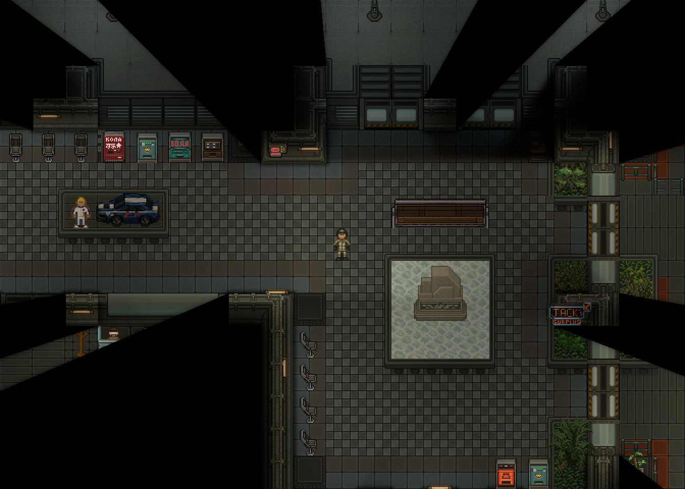
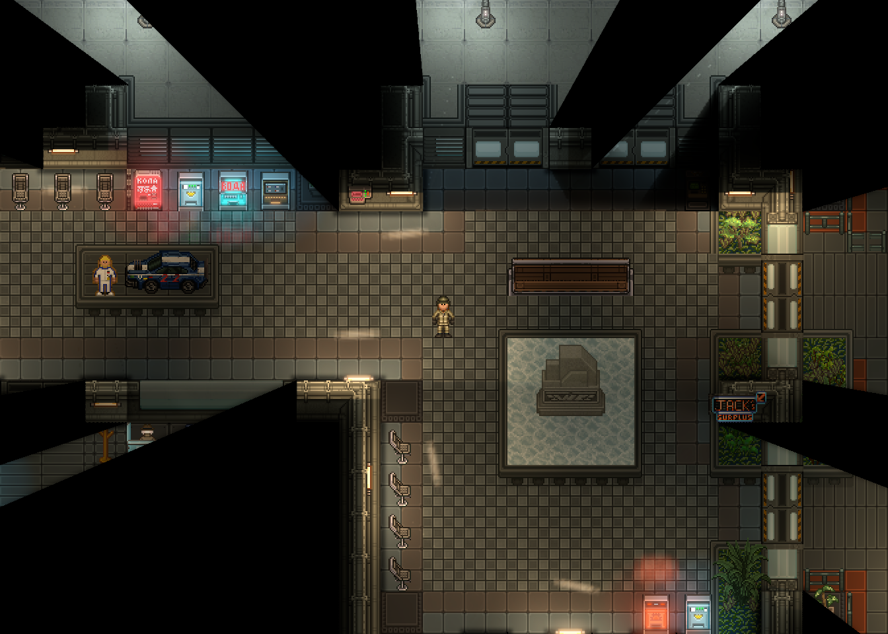
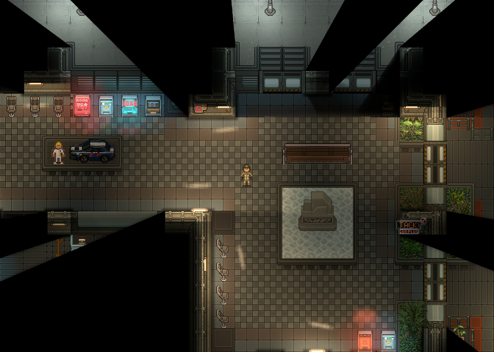
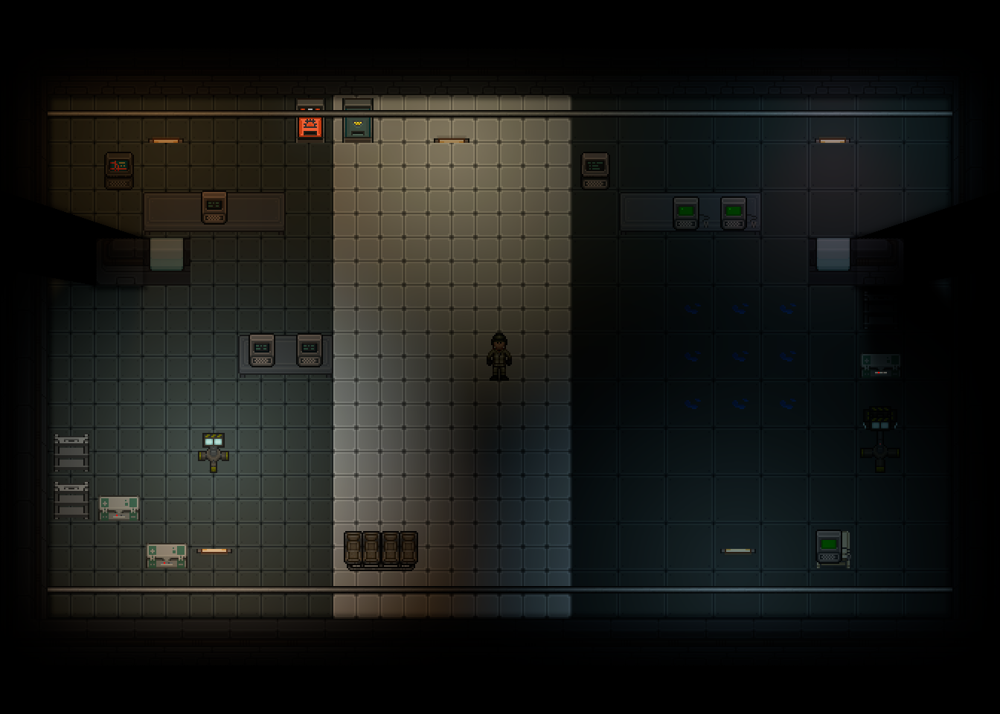
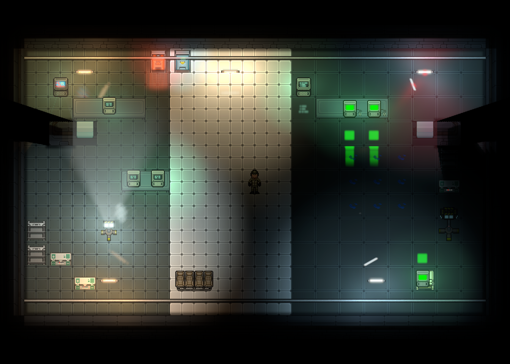

# CMU Cinematic Lighting v2 — 28 октября 2026

Материалы для повторной художественной проверки PR #573. Отклонённая первая версия
сохранена в `../2026-10-28`; её кадры и замеры не подтверждают качество v2.

## Настоящие игровые кадры

PNG сохранены напрямую API игрового viewport, без обработки или генерации. Размер **1344×960**.
Внутри каждого сравнения одинаковы камера, персонаж, предметы, ambient, питание и состояние
мира: перед захватом ставится на паузу только созданная командой тестовая копия карты.
Параметры по умолчанию: экспозиция **1.2**, атмосфера **0.3**, AO **1.2 / 1.25**.
`light.resolution_scale=0.5`, VSync и ограничение FPS выключены.

### Настоящая локация исходного референса

| Исходное | High | Ultra |
|---|---|---|
|  |  |  |

Копия **`/Maps/CMU14/Planets/StableGarrison/StableGarrisonMultiZ0.yml`**, 61 955 записей карты.
Камера **225.5, −145.5**: вендоры, экспозиция автомобиля с фигурой, скамья и бетонная статуя.
Геометрия, объекты и ambient сохранены. Постоянное питание обеспечено через обычный
PowerReceiverSystem только на изолированной копии; производственная карта не редактируется.
Чёрные области штатного FOV оставлены чёрными.

Видны ядра ламп, тёплая засветка стен и пола, холодные/красные экраны и мягкие отражённые полосы
светильников. Персонаж освещается обычным рендерером от нового поля света. High и Ultra
отличаются бюджетом источников/рассеяния, а не дополнительным цветовым фильтром.

### Промышленный интерьер

| Исходное | High | Ultra |
|---|---|---|
|  |  |  |

Металлические стены, матовый/полированный пол, кафель, настоящие связанные лужи, терминалы,
вендоры, трубы, мебель, техника, тёплые/холодные лампы, красный маяк, два прожектора и морпех.
`industrial-static` фиксирует вращение маяка для сравнения; `industrial` сохраняет движение.
Атмосфера локальна и зависит от источника. Мокрый пол вытягивает настоящее изображение экрана.

## Архитектура и причины прежнего слабого изображения

- Три этапа: HDR-свет в native LightRenderTarget **до мира**; отражения материалов **до всех
  сущностей**; ядро, bloom и атмосфера перед hard FOV. Одна выборка источников и один владелец
  ресурсов на viewport. Игровые PointLight не меняются.
- Отдельная модель нейтрального вклада видимых PointLight использует настоящие радиус, энергию,
  цвет и кривую затухания. До 75% этого вклада заменяется компактным авторским светом.
  Минимум четверть штатного света сохраняется; ambient не вычитается. Нет общего затемнения
  кадра. Экспозиция 0 сохраняет исходный свет.
- Новая энергия имеет плавное плечо компрессии **6 в световом буфере**; экранные glow и блики
  сжимаются отдельно. Удалены `readable`, `illumination` и потолок `vec3(0.22)`.
- Эмиссия выделяется из текущего настоящего кадра спрайта, с его слоями, направлением,
  поворотом и смещением. UV-область и фильтр цветности отделяют экран от корпуса/клавиатуры.
  Компактный glow и широкий слабый ореол используют разные масштабы HDR-пирамиды.
- Отражения проецируют весь прямоугольник источника, включая смещённые трубки. Направление
  задаёт открытая геометрия рядом с лампой; размытие 21 выборкой зависит от шероховатости.
  Мокрота непрерывно вытягивает проекцию, связанные мокрые ячейки имеют общий мягкий периметр.
  Добавлены материалы настоящих полов Hybrisa/Strata без ковров и дерева.
- Исправлен нюанс SWSL: `fragment` встраивается в GLSL `main`, поэтому ранний `return`
  пропускал окончательную запись цвета и оставлял пустое поле отражений. Выходы теперь
  находятся в ветвях; блокирующие пиксели используют `discard`.
- Радиантные targets — **R11G11B10F без альфы**. Clyde `add` использует SrcAlpha/DstAlpha;
  RGBA16F давал рекурсию альфы 1 → 2 → 5 → 26 → 677 и пересветы. RGB-формат обеспечивает
  линейную сумму и вдвое меньшую память относительно RGBA16F.
- Native light копируется ровно в своём разрешении. Начало луча совпадает с PointLight:
  удалено смещение, переносившее близкие к стене источники внутрь препятствия.
- Общие параметры источника отправляются один раз на кадр, shader slot стабилен между этапами.
  Свет в руках следует native видимости; скрытый контейнерный спрайт не рисуется поверх актёра.
  Маски материалов проверяют видимость спрайта и цепочки родителей.

RobustToolbox и RSI.NET не изменены. Полный NV, вторичные камеры, нижние Z-проходы и выключенный
свет используют штатный путь. Препятствия и FOV ограничивают все поля.
Подробности: [архитектура и бюджеты](../../README.md).

## Сборка и проверки

- Debug-сборки Content.Shared, Content.Server, Content.Client, Content.Tests,
  Content.IntegrationTests и Content.YAMLLinter: **0 ошибок**, с предупреждениями зависимостей
  и анализаторов. Финальный клиент: 0 ошибок / 235 предупреждений.
- `CinematicLightingGeometryTest`: **19/19** — стены, тонкие преграды, проёмы, повёрнутые
  гриды, бюджеты, импульсы, атмосфера и направление отражений с обеих сторон стены.
- `CinematicLightingIntegrationTest`: **4/4** — восемь SWSL-прототипов, наследование,
  питание, скрытые родители/контейнеры, свет в руках, точное начало PointLight, раздельные uniforms,
  viewport/Z/NV, смена пресетов, RGB HDR, native contribution, resize и освобождение targets.
- Полный YAML linter: **0 ошибок**, `No errors found in 346358 ms`.
- Нативный OpenGL 3.3 / NVIDIA: все четыре пресета отрисованы, SWSL скомпилированы драйвером
  в GLSL. Headless-загрузка отдельно не считается графической проверкой.

В диагностической среде заданы `DOTNET_TieredCompilation=0`, `DOTNET_ReadyToRun=0` из-за
существующего сбоя CLR в динамической сериализации PrototypeManager. Движок не менялся.
Сборки, тесты и linter выполнялись последовательно. Последняя настройка силы отражения
проверена нативной компиляцией и повторной отрисовкой; C# после тестов не менялся.
CI не ожидается по указанию пользователя.

## Производительность

Windows, RTX 3060 Ti, i7-12700F, 32 ГБ RAM, .NET 10, **Debug**. Окно 1920×1080,
внутренний viewport **1344×960**. Две секунды прогрева, шесть секунд измерения на пресет.
Во время обычных замеров сборки, тесты, linter и RenderDoc не выполнялись.
Другие приложения рабочего стола, включая отдельный SS14.Loader, продолжали работать.
Видеокарта целиком не изолирована; эти результаты являются диагностикой на рабочем компьютере.

| Сцена / режим | Средний кадр, мс | p50 | p95 | p99 | CPU CMU, мс | Источники / атмосфера |
|---|---:|---:|---:|---:|---:|---:|
| Референс / Off | 5.540 | 5.139 | 8.260 | 9.802 | 0 | 0 / 0 |
| Референс / High | 7.852 | 7.175 | 10.709 | 14.555 | 2.451 | 37 / 6 |
| Референс / Ultra | 9.244 | 7.268 | 10.902 | 75.096 | 3.947 | 37 / 12 |
| Стенд / Off | 3.573 | 3.307 | 5.691 | 6.444 | 0 | 0 / 0 |
| Стенд / High | 5.273 | 4.866 | 7.776 | 8.973 | 1.349 | 17 / 6 |
| Стенд / Ultra | 5.326 | 4.891 | 7.886 | 8.810 | 1.376 | 17 / 7 |

Исходные интервалы: [референс](reference/frame-times.log), [стенд](industrial/frame-times.log).
Это полный клиентский кадр, не время GPU. CPU CMU включает отбор и отправку эффектов;
native screen copies и обычный AO в него не входят. Короткий Debug-замер не характеризует бой
или Release; в Ultra на реальной карте остался скачок p99, его нельзя скрывать средним FPS.

High: **12 targets, 19 776 960 байт (18.86 МиБ)**; Ultra: **13 targets, 19 782 000 байт**
при этих размерах viewport/native света. Память зависит и от native light resolution.
Исходные native/stencil targets и драйвер не входят. Эмиссия/препятствия — полное разрешение,
остальные поля — половинное, bloom уменьшается пирамидой. High выполняет 15 ограниченных
проходов, Ultra — 16, плюс запрашиваемые движком screen copies и общую маску тайлов.

### GPU-события RenderDoc

RenderDoc 1.44, та же сцена референса с 37 источниками, внутренний viewport **2016×1440**
при окне 2560×1440. По три захваченных кадра Off / High / Ultra. Обычный клиент закрыт перед
replay. Каждый capture дополнительно воспроизведён перед измерением `EventGPUDuration`.
Суммируются отдельные draw/clear, без повторного учёта вложенных маркеров.

| Режим | Собственные draw/clear, медиана мс | Диапазон мс | Сумма всех событий, медиана мс |
|---|---:|---:|---:|
| Off | 0 | 0 | 3.987 |
| High | 1.510 | 0.905–1.511 | 3.854 |
| Ultra | 2.412 | 0.919–5.403 | 4.809 |

Разброс у Off и Ultra остаётся большим. Эти суммы не равны Present или полному времени кадра,
разность медиан Off/High не является стоимостью эффекта при общей нагрузке GPU. Собственная
сумма включает поля и композитинг CMU, но не native screen copies и обычный AO. Стабильный
GPU-бюджет 2 мс для всех условий **не подтверждён**; Ultra требует дальнейшей проверки под нагрузкой.

[Все 9 измерений и HDR](gpu-samples.json), [события и роли](gpu-events.csv),
[первый прогон без дополнительного прогрева](gpu-unwarmed-samples.json).
Шесть HDR-полей имеют конечные значения без NaN/Inf: максимум RGB эмиссии **6.56**,
irradiance **7.56**, отражений **0.72**, атмосферы **0.73**. Отражённое поле действительно
содержит источник и поступает в surface composite, а не остаётся формально существующим target.

Для воспроизведения GPU-анализа: сохранить captures и `bin/cinematic-demo/gpu-preset-files.json`
как массив объектов `quality` (0/2/3) и `path` (абсолютный путь RDC); из корня checkout запустить
`qrenderdoc --python Content.CMU/Client/Lighting/Validation/2026-10-28-v2/profile-renderdoc.py`.
RDC и установленный RenderDoc в репозиторий не включаются. Проверка PNG:
`python .../check-comparison.py .../reference` (требуется Pillow).

## Диагностика и видимость

В папках сцен сохранены High targets: исходный/итоговый native light, native contribution,
blockers, emission, materials, irradiance, reflections, atmosphere и bloom. Восьмибитный PNG
не сохраняет HDR-энергию выше 1; числовая проверка выполняется по исходным GPU-текстурам.
Чтения текстур обратно на CPU в обычной игре нет.

[Проверка чёрных пикселей референса](reference/fov-comparison.json): среди 356 999 пикселей
связной с краем чёрной области, после отступа 3 пикселя, изменений **0** в High и Ultra.
[Стенд](industrial/fov-comparison.json): 98 из 208 361 исходно чёрных пикселей у края стены
получили слабый сигнал (до нескольких уровней RGB). Это эвристика изображения: исходный чёрный
может быть видимой неосвещённой поверхностью, а не FOV. Она не доказывает полную корректность
всех видов видимости; окончательный hard FOV остаётся за движком.

## Воспроизведение и ограничения

```text
cmu_cinematic_demo [player] reference
cmu_cinematic_demo [player] capture
cmu_cinematic_demo [player] industrial-static
cmu_cinematic_demo [player] capture
```

Требуется Mapping; на локальном сервере имя имеет вид `localhost@Username`.
Делать capture сразу после создания стенда, до обычного исчезновения луж.
Качество, VSync и FPS limit восстанавливаются. После правки SWSL:
`cmu_cinematic_demo [player] reload`; `watch` включает штатный shader watcher.

Это стилизованная проекция источников и локальное рассеяние средствами Content, без зеркального
отражения всей сцены, normal maps, GI и физического PBR. Концепт не воспроизводится буквально.
Большой бой, Release, все виды NV-снаряжения и все сочетания камер/Z-уровней не проверены
в живом раунде; для последних есть ограничения пути и интеграционные регрессии.
Модель нейтрального native вклада приближённая: жёсткая геометрия Content отличается от мягких
теней Clyde. Ограничение замены 75% сохраняет запас штатного света при расхождении моделей.
Кадры предназначены для повторной художественной приёмки и не заменяют оценку пользователя.
