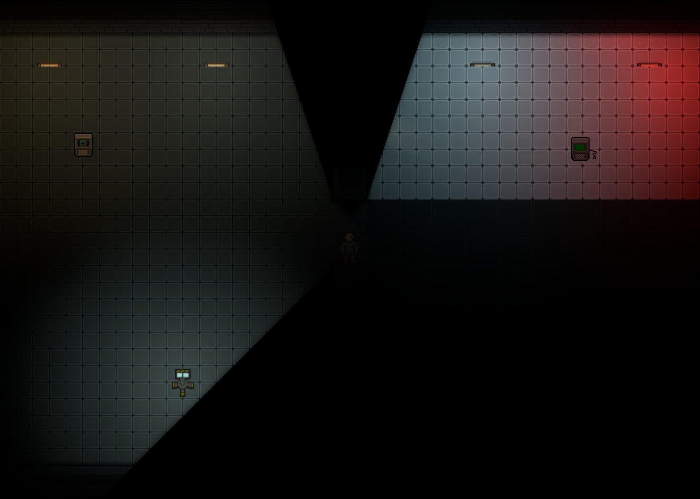
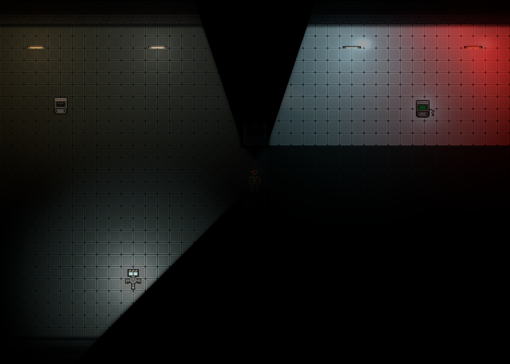

# Проверка CMU Cinematic Lighting — 28 октября 2026

**Историческая первая версия, отклонённая при художественной приёмке.** Эти кадры и замеры
не подтверждают качество переработанного освещения. Актуальные материалы находятся в
[2026-10-28-v2](../2026-10-28-v2/README.md).

## Сборка и автоматические проверки

- Debug: Content.Shared, Content.Server, Content.Client, Content.Tests,
  Content.IntegrationTests и Content.YAMLLinter собираются без ошибок.
  Сборки имеют предупреждения зависимостей и анализаторов.
- `CinematicLightingGeometryTest`: **16/16**, включая тонкие/повёрнутые препятствия,
  дверной проём, переполнение бюджета, импульсы и пользовательскую плотность атмосферы.
- `CinematicLightingIntegrationTest`: **4/4**. Проверены загрузка SWSL/прототипов,
  раздельные параметры источников, питание и невидимые родители, несколько viewport,
  Z/NV-ограничения, смена пресетов, RGB-очистка масок, resize и однократное освобождение targets.
- Нативный клиент действительно запущен на NVIDIA: SWSL скомпилирован драйвером в GLSL,
  все четыре режима последовательно отрисованы. Кадры ниже получены API самой игры.
- Полная штатная проверка YAML клиента и сервера: **0 ошибок**, `No errors found in 292361 ms`.
  Её результат не входит в приведённый счётчик тестов. CI после открытия PR не ожидается.

Воспроизведение тематических проверок, после обычной сборки проектов:

```powershell
$env:DOTNET_TieredCompilation = '0'
$env:DOTNET_ReadyToRun = '0'
dotnet test Content.Tests/Content.Tests.csproj -c Debug --no-build --no-restore --filter 'FullyQualifiedName~CinematicLightingGeometryTest'
dotnet test Content.IntegrationTests/Content.IntegrationTests.csproj -c Debug --no-build --no-restore --filter 'FullyQualifiedName~CinematicLightingIntegrationTest'
```

Отключение tiered/R2R применялось в локальной диагностической среде из-за сбоя CLR
в динамической сериализации PrototypeManager; исходники движка не изменялись.
Проверки запускались последовательно, с доступной локальной связью тестовых процессов.

## Настоящие игровые кадры

Сцена создаётся командой `cmu_cinematic_demo`: две комнаты с лампами, терминалами,
металлом/кафелем/стеклом, водой, прожекторами и аварийным маяком. Положение камеры фиксировано.
Чёрные секторы — штатная отсечка видимости стенами. Эффекты их не заполняют.

| Исходное освещение | Высокое |
|---|---|
|  |  |

Также сохранены [низкое](quality-1.png) и [ультра](quality-3.png).
Это прямые кадры игрового viewport без интерфейса, без обработки изображения.
Изображения содержат существующие игровые ассеты, лицензии которых остаются в исходных ресурсах.

Для проверки проходов: [эмиссия](high-bloom-0.png), [bloom 1](high-bloom-1.png),
[bloom 2](high-bloom-2.png), [препятствия](high-blockers.png),
[материалы](high-materials.png), [засветка и атмосфера](high-effects.png).
Прозрачные области диагностических PNG могут отображаться белыми в просмотрщике.
В пустой области маски препятствий проверено RGBA=(0,0,0,0).

## Измерения этого запуска

Windows, RTX 3060 Ti, Core i7-12700F, 32 ГБ RAM, .NET 10, **Debug**.
Размер внутреннего игрового viewport — **1344×960**; размер окна был задан 1920×1080.
VSync и ограничитель кадров отключены. Две секунды прогрева и шесть секунд измерения на пресет.
В сцене обработано восемь источников, до шести атмосферных.

| Режим | Средний кадр, мс | p50, мс | p95, мс | p99, мс | Отправка CMU CPU, мс | Свои targets |
|---|---:|---:|---:|---:|---:|---:|
| Выключено | 2.857 | 2.649 | 4.697 | 5.069 | 0 | 0 |
| Низкое | 3.183 | 2.947 | 5.026 | 5.507 | 0.201 | 3 |
| Высокое | 3.609 | 3.360 | 5.480 | 5.949 | 0.506 | 6 |
| Ультра | 3.717 | 3.436 | 5.590 | 6.173 | 0.528 | 7 |

Источник: неизменённый [frame-times.txt](frame-times.txt). Средняя разница высокого режима
и исходного составляет **0.752 мс** в этой небольшой сцене. Это интервалы полного клиентского
кадра при локальной проверке, а не отдельные GPU timestamps и не изолированный Release-бенчмарк.
CPU-счётчик не включает отбор источников, native screen copy и обычный AO.
Свои targets высокого режима занимают около 9 МиБ, без native/stencil targets и расходов драйвера.

## Границы подтверждённого результата

GPU-ориентир около 2 мс при 1920×1080 отдельно **не измерен**. Большой бой, ручной проход всех
карт, переключение всех типов оптики и живые многоуровневые сцены не профилировались.
Их нужно проверять в Release по инструкции в основном README. Автоматические тесты границ
viewport/Z/NV не заменяют такую игровую проверку.

GI, отражения и объёмный свет стилизованы средствами 2D-рендеринга. Вторичные камеры и полный NV
используют штатную графику; дополнительные эффекты Z применяются только на текущем уровне.
Скрытые и контейнерные эмиттеры исключаются. Ни один игровой радиус света не изменяется.
