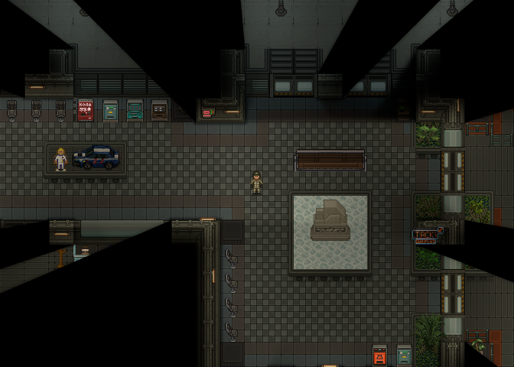
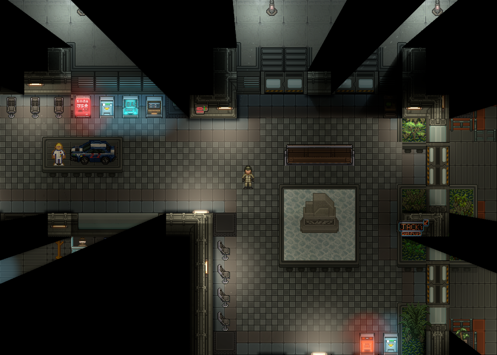
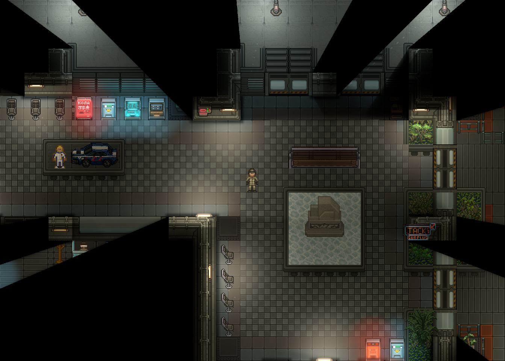

# CMU Cinematic Lighting v3 — 29 октября 2026

Продолжение PR #573 после визуальной проверки v2. Сравнения ниже используют настоящий
StableGarrisonMultiZ0: исходные архитектура, предметы и ambient сохранены. Движок не изменён.

## Что исправлено

### Полосы и прямоугольные пятна

Главный источник полос находился в reflections: изображение светящейся трубки растягивалось
по всему прямоугольнику RSI. Такая проекция переносила на кафель узкую светлую планку.
Теперь отражённый свет формирует мягкий отклик площадного источника: размер и цвет лампы,
направление открытой поверхности, отражательная способность, шероховатость и мокрота задают
форму блика. Прямоугольник спрайта и его пиксельная картинка на пол не копируются.

В irradiance плоская метрика `max(abs(x)-span,0)` давала участки с постоянным уровнем света.
Она заменена интегрированием трёх точек вдоль источника с непрерывным спадом. Слабый вторичный
вклад сохранён локальным. Геометрические тени и чёрный FOV не размываются.

Проверенные промежуточные итерации на той же локации:

- [Первый кадр после замены отражений](iterations/01-area-response.png),
  [его отражённое поле](iterations/01-reflections.png).
- [Следующий кадр после изменения смешивания света](iterations/02-local-energy.png),
  [его irradiance](iterations/02-irradiance.png).

Это промежуточные кадры со старыми профилями; итоговая серия находится ниже.

### Композиция и материалы

Удалено перекрашивание нейтрального native света по широкому хвосту irradiance. Оставшийся
native свет сохраняет свой цвет; локальный оттенок возникает за счёт добавленной энергии.
Нет общей цветовой маски или затемнения готового изображения.

Обычные люминесцентные лампы используют сдержанный профиль CMUFixture, промышленный профиль
CMUIndustrial сохраняет янтарный цвет. Вендоры получили более широкую локальную холодную
засветку; красные панели имеют отдельный профиль. Синие штатные лампы сохраняют свой цвет.

Полированный металл концентрирует блик, кафель даёт более слабый и широкий отклик, вода
вытягивает его вдоль поверхности. Соседние мокрые ячейки имеют общий мягкий внешний край.
Положение блика определяется настоящим источником и его отсечённой геометрией видимости.
Повторяющаяся текстура бликов не генерируется.

### Свечение и глубина

Маски трубок выделяют ядро по линейной светимости: яркие оранжевые торцы корпуса не становятся
вторым светящимся элементом. Цветные экраны используют самый яркий канал, сохраняя красные
и синие LED. Текущие кадры, слои и направления настоящих спрайтов остаются источником эмиссии.
Компактное свечение и мягкий внешний ореол имеют разные масштабы.

Отражённое поле теперь рисуется перед штатным контактным AO. Тень затеняет пол вместе
с отражением, поэтому блики не закрашивают контактные углубления поверх готовой тени.
Персонажи рисуются после этих этапов и получают свет через обычный native рендерер.
Дополнительного полноэкранного прохода затенения не добавлено.

## Итоговые реальные кадры

PNG получены напрямую API игрового viewport, без обработки или генерации.
Камера зала: **225.5, −145.5**. Для сравнения тестовая карта и тестовый персонаж зафиксированы.
Off / High / Ultra используют одинаковые камеру, объекты, питание и настройки.

| Исходное | High | Ultra |
|---|---|---|
|  |  |  |

Поля High сохранены рядом: native light до/после, native contribution, emission, irradiance,
reflections, materials, blockers, atmosphere и bloom. Восьмибитные диагностические PNG не
сохраняют диапазон HDR выше 1; количественная проверка выполняется по исходным GPU-текстурам.

## Процедура измерения и устранённые затраты

Раньше после High запрашивались readback и PNG-кодирование множества targets, после чего
начинался замер Ultra. Отложенные операции и их давление на память могли пересекаться с ним.
Теперь **все четыре временных замера завершаются до любого чтения изображений**. Только затем
выполняется отдельный цикл screenshot/diagnostic capture.

Захват записывает фактические параметры света, UTC начала этапа, худший полный кадр, время
CMU в нём и максимальное CPU-время CMU. Изменение камеры, размера viewport или параметров
света останавливает сравнение; отсутствие источников в High/Ultra также отвергается.

Убраны прежние 21 выборка emissive-текстуры из каждого отражения и покадровый расчёт границ
спрайта. Буфер выборок диагностического измерителя выделяется при запуске команды, а не
при обычном создании игрового ECS. Новых targets или проходов для этих изменений нет.
Неизменные скалярные и векторные параметры профилей кешируются внутри ограниченного пула
источников: это сокращает повторную упаковку значений публичным Shader.SetParameter.
Изменение параметра инвалидирует соответствующий слот; динамические параметры обновляются.

Встроенные вызовы System.GC не используются: CLR анализируется внешним dotnet-trace.
Обычный клиентский кадр, собственная CPU-отправка CMU и GPU-события рассматриваются отдельно.
Средний FPS и единичная GPU-выборка не доказывают отсутствие выбросов.

### Полные интервалы кадра после последней оптимизации

Windows, RTX 3060 Ti, i7-12700F, 32 ГБ RAM, .NET 10, **Debug**, окно 1920×1080,
сохранённый world viewport **1344×960**. На каждый режим 2 с прогрева и 30 с измерения.
Сборки, тесты, RenderDoc и readback в этот интервал не выполнялись. Другие приложения
рабочего стола продолжали работать; GPU не изолирован.

| Режим | Средний кадр, мс | p50 | p95 | p99 | CPU CMU, мс | Худший кадр, мс | CPU CMU в нём, мс |
|---|---:|---:|---:|---:|---:|---:|---:|
| Off | 4.828 | 4.379 | 7.303 | 8.946 | 0 | 27.502 | 0 |
| Low | 5.317 | 4.897 | 7.751 | 8.966 | 0.432 | 11.814 | 0.750 |
| High | 7.258 | 6.694 | 9.634 | 10.672 | 2.204 | 17.609 | 4.286 |
| Ultra | 7.591 | 7.072 | 9.996 | 11.014 | 2.397 | 38.186 | 2.348 |

[Исходный отчёт](reference/frame-times.log). High/Ultra: 36 источников, 6/12 атмосферных,
12/13 targets, 19 776 960 / 19 782 000 байт. Максимальный CPU CMU за Ultra — 5.198 мс.
Это время отбора/отправки CMU, без native screen copies и AO; полный кадр включает весь клиент.
У единичного полного кадра 38.186 мс CPU-этап CMU не вырос вместе с ним. Это не доказывает
конкретную внешнюю причину и не является гарантией отсутствия выбросов в игре.

Фактические настройки зафиксированы в отчёте: exposure 1.2, atmosphere 0.3, native light scale 0.5,
AO включён, интенсивность 1.2, радиус 1.25; поворот 0, zoom 1, FOV включён.
В High/Ultra изменено **0 из 356 999** пикселей глубокой связной чёрной области:
[проверка PNG](reference/fov-comparison.json). Эвристика не заменяет геометрические тесты видимости.

### GPU и HDR

RenderDoc 1.44, тот же зал и 36 источников; окно 2560×1440, world viewport **2016×1440**.
По три кадра на Off/High/Ultra; обычный клиент закрыт перед replay. Каждый capture сначала
воспроизводится для прогрева, затем измеряется EventGPUDuration. Вложенные маркеры повторно
не суммируются; в собственную стоимость включены CMU draw/clear.

| Режим | CMU, медиана мс | Диапазон мс | Все GPU-события, медиана мс |
|---|---:|---:|---:|
| Off | 0 | 0 | 1.580 |
| High | 2.462 | 1.877–2.585 | 4.056 |
| Ultra | 2.996 | 2.833–3.040 | 4.594 |

[Все 9 samples и HDR](gpu-samples.json), [операции с ролями](gpu-events.csv).
В Ultra основная средняя стоимость — emission 1.083 мс и три spill-прохода 1.263 мс;
атмосфера 0.039 мс. Native screen copies и штатный AO не входят в собственную сумму CMU.
Это суммы GPU-событий, не Present и не полный кадр. **Стабильный бюджет 2 мс не достигнут**
при этом разрешении. Разницу с v2 нельзя целиком приписывать коду: фон GPU и состав источников
не идентичны. Захват под RenderDoc намеренно не используется как обычный FPS-тест.

Все шесть полей R11G11B10F конечны, без NaN/Inf. Максимум каналов: emission **8.375**,
irradiance **5.063**, reflections **0.289**, atmosphere **0.727**. Ненулевое поле отражений
читается surface composite до AO. Диагностические PNG сохраняют только восьмибитный цвет;
яркие HDR-участки могут выглядеть ложными цветами, поэтому их энергию проверяем по raw GPU-данным.

Воспроизведение анализа: сохранить собственные RDC и manifest
`bin/cinematic-demo/gpu-preset-files.json` с полями quality (0/2/3) и path, затем из корня
checkout выполнить `qrenderdoc --python .../profile-renderdoc.py` из этой папки.
Для анализа CLR приложен [analyze-clr.cs.txt](analyze-clr.cs.txt), использующий TraceEvent из локальной
установки dotnet-trace; аргументы — nettrace, frame-times.log, выходной JSON.
Двоичные RDC, nettrace, RenderDoc и dotnet-trace в репозиторий не включены.

### CLR и прежний p99

До последнего кеширования параметров собран внешний `gc-verbose` trace длительностью 140 с.
В нём 81 пауза GC, потерянных событий нет. Во время 20-секундных замеров получены:

| Режим | Пауз GC | Сумма пауз, мс | Максимальная пауза, мс |
|---|---:|---:|---:|
| Off | 7 | 4.403 | 0.870 |
| Low | 9 | 4.272 | 0.525 |
| High | 14 | 8.856 | 0.785 |
| Ultra | 14 | 9.420 | 0.929 |

[Разбор CLR](clr-analysis.json), [одновременные интервалы кадров](trace-frame-times.log).
В выборках аллокаций всего клиента преобладали упакованные Single, Vector2 и Boolean.
Это не атрибуция всех выделений CMU: trace включает движок и прочие системы клиента.
Проверка исходного Shader.SetParameter подтвердила повторную упаковку неизменных параметров
в CMU; она устранена ограниченными кешами.

Выброс 75 мс из v2 в новых прогонах не воспроизведён. У прежнего прогона нет CLR/GPU-трейса,
поэтому точная ретроспективная причина не доказана. Пересечение readback/PNG с измерением
Ultra было дефектом методики; оно устранено, а не скрыто фильтрацией результатов.

### Отдельная проверка материалов

Дополнительно снят промышленный стенд с металлом, кафелем и настоящей водой:
[Off](industrial/quality-0.png), [High](industrial/quality-2.png), [Ultra](industrial/quality-3.png),
[поле отражений](industrial/high-reflections.png). Вода смешивает сухой и вытянутый отклики;
интерполяция положения блика через границу лужи больше не создаёт вторую яркую полосу.
Основная художественная проверка остаётся на StableGarrisonMultiZ0.

## Проверки и воспроизведение

- Сборки клиента и сервера — 0 ошибок, с предупреждениями зависимостей и анализаторов.
- Геометрические регрессии — **19/19**, интеграционные — **4/4**.
- Полный YAML linter — **0 ошибок**, `No errors found in 318394 ms`.
- Shader compilation проверяется настоящим нативным OpenGL-клиентом, а не только headless.
- RobustToolbox, RSI.NET, механика FOV и игровые параметры PointLight не изменены.

```text
cmu_cinematic_demo [player] reference
cmu_cinematic_demo [player] capture 30
cmu_cinematic_demo [player] industrial-static
cmu_cinematic_demo [player] capture
```

Нужен Mapping; локальное имя имеет вид `localhost@Username`. После переподключения нужно
проверить точное имя в `listplayers`: оно может получить суффикс `_2`. Не перемещать камеру
и не менять графику между пресетами. Для фиксированного персонажа применяется штатный AdminFrozen только
на изолированном стенде. Настройки качества, VSync и лимит FPS восстанавливаются после захвата.

## Ограничения

Это стилизованный 2D-отклик площадного источника, а не зеркальное отражение всей сцены,
normal mapping, GI или физический PBR. Модель native вклада приближённая; минимум четверть
штатного света сохраняется при расхождении жёсткой геометрии Content и мягких теней Clyde.
Большой бой, Release, все виды NV и все сочетания камер/Z-уровней не проверены в живом раунде.
Эти материалы предназначены для художественной оценки и не означают автоматического прохождения приёмки.
