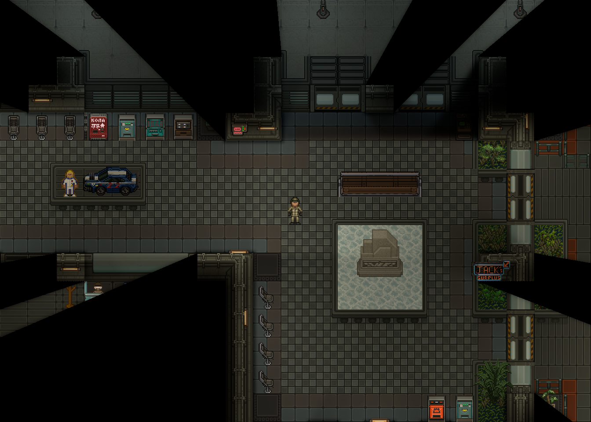
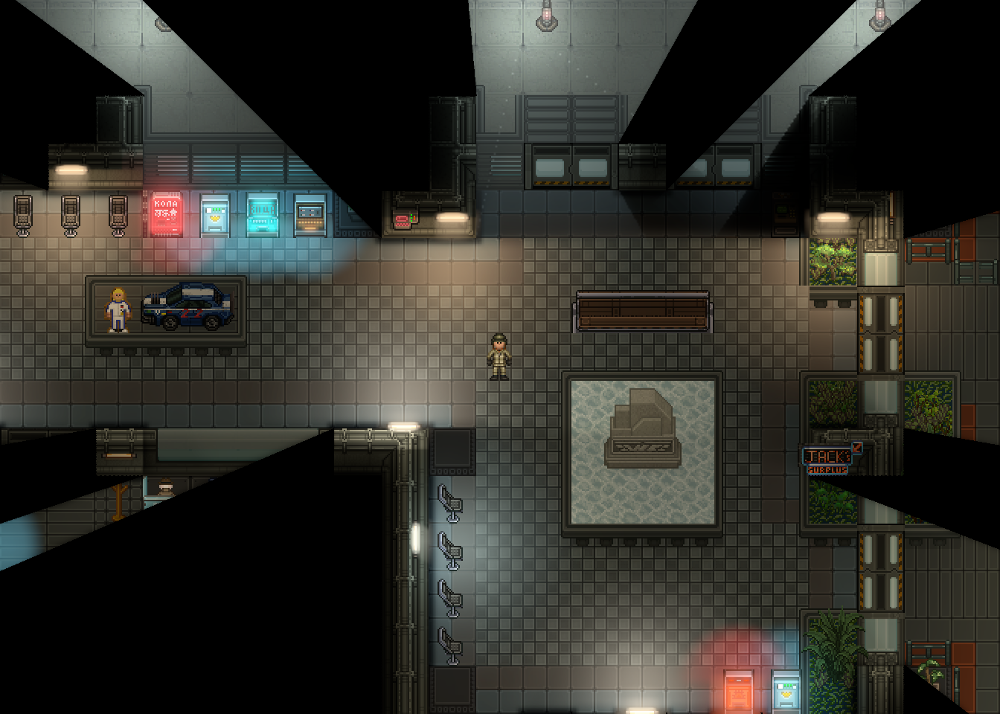
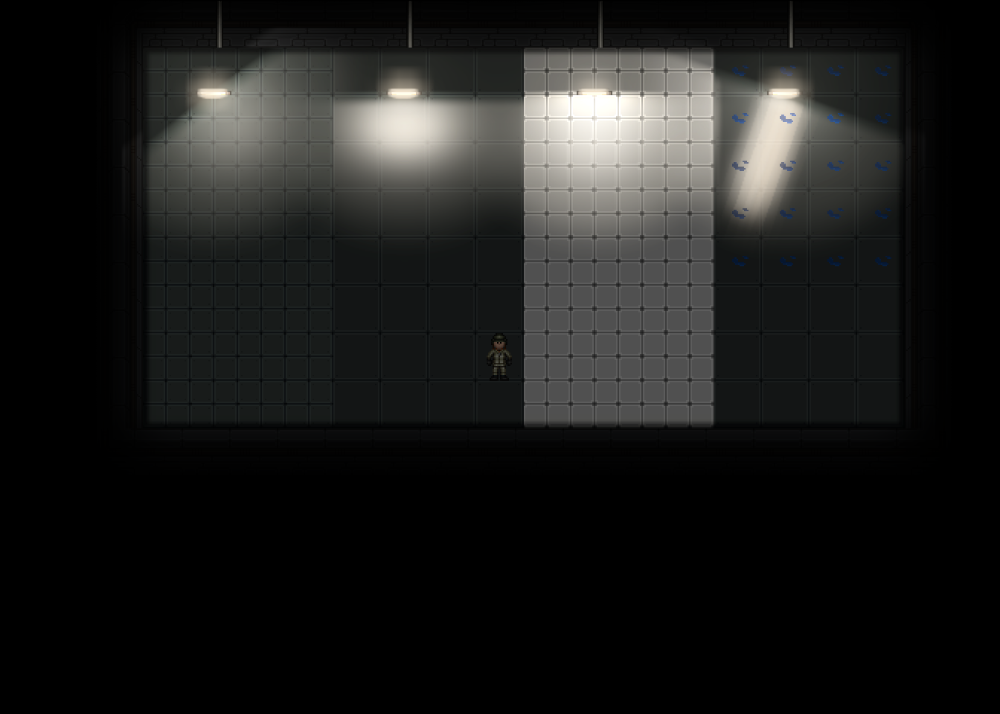
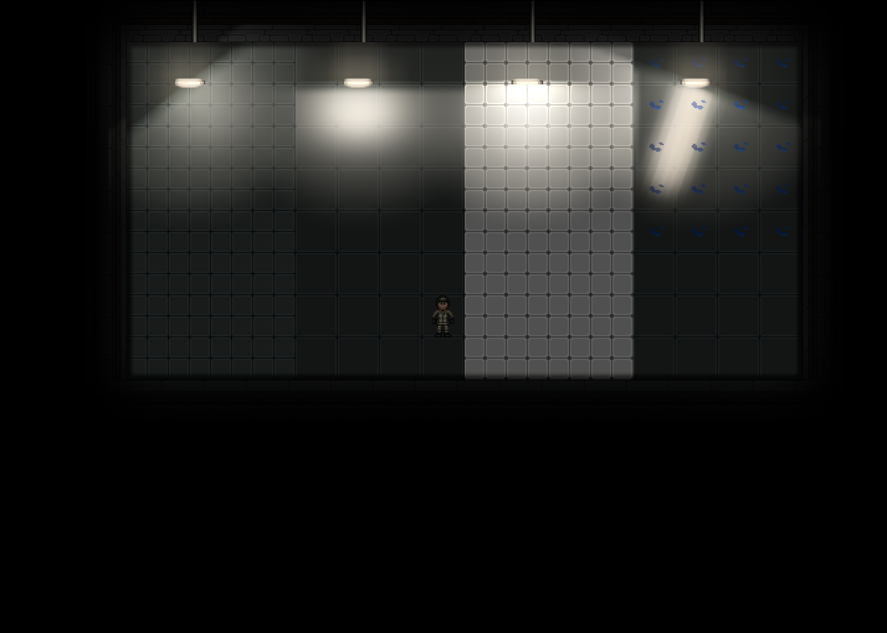

# V4: объединение optical targets и приёмник непрозрачной воды

Продолжение [основного отчёта V4](../2026-10-29-v4/README.md), PR #573.
Все изображения получены игровым клиентом; PNG не ретушировались и не генерировались.
Метрики служат проверками регрессий, художественную приёмку выполняет человек.

## Изменения

Независимые inner/outer seed-поля размещены в двух половинах одной HDR-текстуры.
Площадь, разрешение и энергия полей сохранены. Одна очистка и переключение target
заменяют два. Проекция геометрии и UV ограничены своей половиной; фильтрация зажимается
в центрах её крайних texel. Core остаётся отдельным half-resolution/nearest target.
High теперь владеет 12 targets, Ultra — 13, Low — 6. Байтовая ёмкость High/Ultra
при 1344×960 остаётся 17 196 480 / 17 201 520.

Непрозрачная RMC-вода раньше перекрывала отражение пола своим поздним спрайтом.
Её текущие видимые кадры RSI теперь записывают wet material через настоящую alpha.
Добавленный WorldSpaceEntities overlay использует уже рассчитанное отражённое поле
после BelowFloor-воды и до FloorTiles, ковров, мебели и персонажей. Нового полноэкранного
target, копии игрового изображения или зеркального мира нет. Источники и native свет не меняются.
Верхние слои, невидимые/контейнерные спрайты и чужие карты исключаются.

Живой стенд выявил ещё один стык: штатный RMC post-shader погружения подменяет нижнюю
часть тела собственной копией воды с native light. Общая Content-функция `water-response.swsl`
теперь используется и этим шейдером, и водным приёмником. Нативные water line, глубина,
силуэт, opacity, цвет и анимированный кадр не меняются. CMU задаёт только дополнительный
отклик водной копии для реально собранного BelowFloor-приёмника текущего viewport.
При Off/Low, отключённых отражениях, NV, debug или неподходящем viewport флаг выключается,
а ссылки на собственные targets заменяются постоянной белой текстурой. Таким образом
native shader не удерживает освобождённые targets после переключения качества/размера.
Единственное изменение за пределами CMU — помеченное расширение Content-шейдера
`Resources/Textures/_RMC14/Effects/Water/submersion.swsl`; RobustToolbox не изменяется.

Для мокрого материала добавлен слабый широкий отклик, связанный с тем же источником,
его шероховатостью, геометрией и плавным краем радиуса. Короткая направленная проекция
светящейся области сохраняется. Это устраняет почти нулевой отклик воды вне узкой оси
светильника без увеличения всех источников или глобального фильтра.

| Данные | Запись и использование | Видимость |
|---|---|---|
| Inner / outer | OpticalSeeds, левая / правая половина → соответствующие уровни bloom | Прежние source/FOV/path/barrier-проверки; межполовинная фильтрация исключена |
| Water material | Настоящий кадр, alpha, transform → существующий materials | RMCWater, BelowFloor, видимость всех родителей и native sprite |
| Water specular | Существующий reflections → настоящие пиксели воды ниже персонажей | Source mesh, FOV получателя, реальная alpha, штатный финальный hard FOV |
| Submerged water copy | Те же reflections/blockers → водная часть штатного post-shader | Только настоящий собранный receiver; исходная маска и прозрачность тела сохранены |
| Contact | Существующий blockers.B → ослабление водного блика | Только ранее сертифицированные видимые основания, максимум 20% |

Обычный floor specular по-прежнему проходит через native AO. Водный overlay расположен
позже AO, поскольку сама непрозрачная вода уже перекрывает ранний пол; он использует
существующее контактное поле B. Native AO для этого позднего водного вклада не заявляется.

## Настоящая карта и материалы

StableGarrisonMultiZ0, камера (225.5, −145.5), viewport 1344×960. Обстановка,
питание, ambient и камера фиксируются одной процедурой capture для четырёх пресетов.

| Off | High | Ultra |
|---|---|---|
|  |  |  |

[Low](reference/quality-1.png), [источники](reference/sources.csv),
[проверки изображения](comparison.json). Исходные targets сохранены рядом с кадрами.
Их восьмибитные PNG служат геометрической диагностикой; HDR-значения проверяются отдельно.

Матовый металл / полированный металл / кафель / мокрый металл под одинаковыми лампами:

| Off | High | Ultra |
|---|---|---|
|  |  |  |

[Low](materials/quality-1.png), [метрики](material-metrics.json).
Промышленные состояния alarm/spotlight/screens-off и сравнение source-off сохранены
в [предыдущем наборе V4](../2026-10-29-v4/README.md); здесь изменён именно приёмник воды.

## Воспроизведение

На изолированном review-сервере с административным доступом:

```text
cmu_cinematic_demo localhost@Username reference
cmu_cinematic_demo localhost@Username view 225.5 -145.5
cmu_cinematic_demo localhost@Username capture 30
cmu_cinematic_demo localhost@Username materials
cmu_cinematic_demo localhost@Username capture 3
cmu_cinematic_demo localhost@Username water
cmu_cinematic_demo localhost@Username capture 3
cmu_cinematic_demo localhost@Username debug disable reflections
cmu_cinematic_demo localhost@Username capture 3
cmu_cinematic_demo localhost@Username debug enable reflections
cmu_cinematic_demo localhost@Username state lamp-off
cmu_cinematic_demo localhost@Username capture 3
```

`materials` сохраняет прежний четырёхматериальный контроль. Новый `water` добавляет
на отдельной review-карте настоящую RMC-воду под двумя средними лампами и морпеха.
Производственная StableGarrison не редактируется. Пороговые значения
Tools/CMU14/Lighting/quality-regions.json сохранены без изменений.
`capture` закрепляет наблюдателя через AdminFrozen и ставит только review-карту на паузу;
это также блокирует клиентское предсказание движения при переключении фокуса окна.
Для свободного перемещения после приёмки снимите AdminFrozen с тестового наблюдателя.

Параметры клиента: exposure 1.2, atmosphere 0.3, AO включён, intensity 1.2 / radius 1.25,
native light scale 0.5, zoom 1. Для сопоставимости .NET:
DOTNET_TieredCompilation=0, DOTNET_ReadyToRun=0. Выключение пресета возвращает native pipeline.

## Пределы проверки

Отражения остаются стилизованной 2D-моделью. Вода поддерживается для RMCWater на BelowFloor,
не для произвольных поздних полупрозрачных спрайтов. Маска обычных луж остаётся связной
площадью реальных ячеек со сглаженным краем. Полного GI, normal-map PBR и зеркальной сцены нет.
Полная живая боевая матрица NV/ксеноморфы/взрывы/камеры/несколько Z не выполнена;
контрактные headless-проверки этих ограничений не выдаются за такую приёмку.
