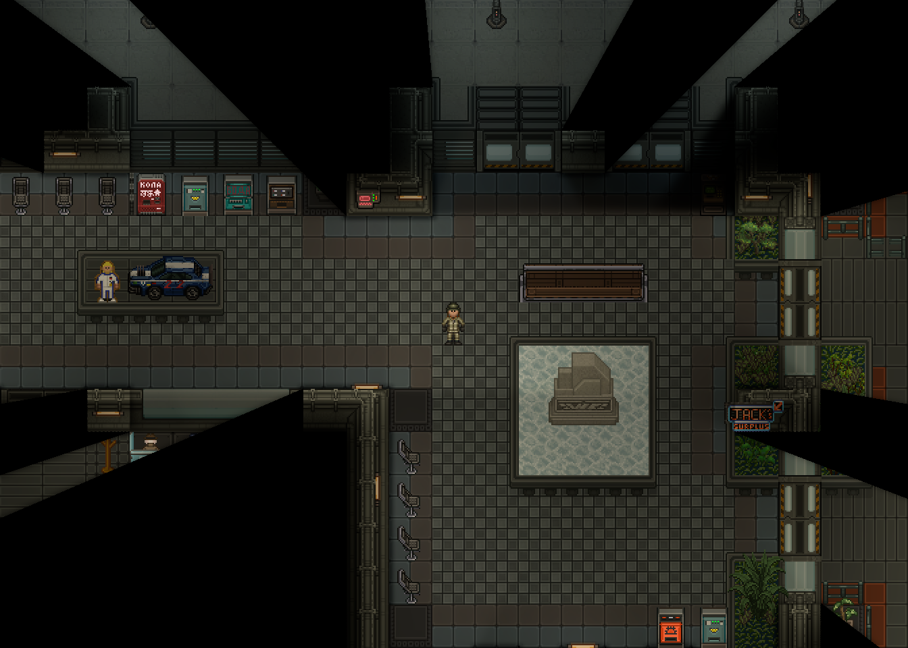
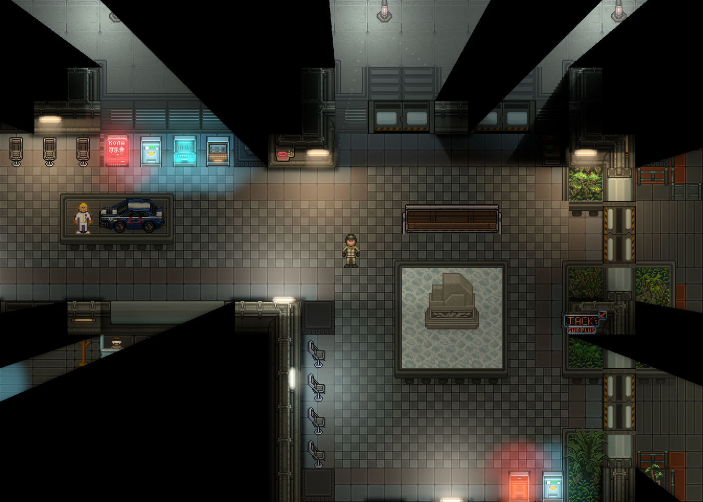
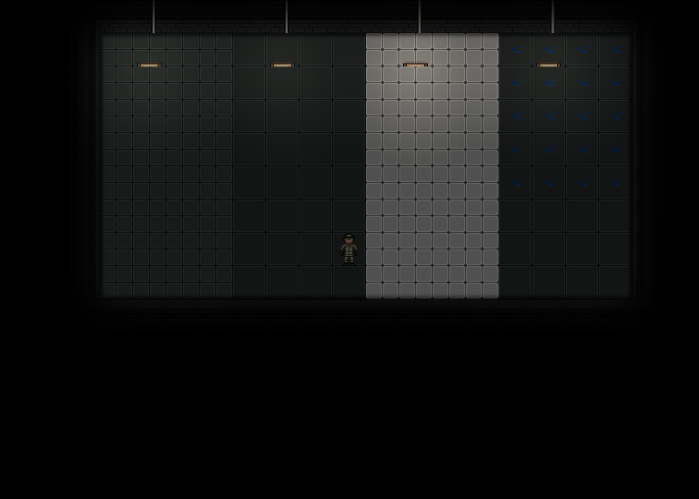
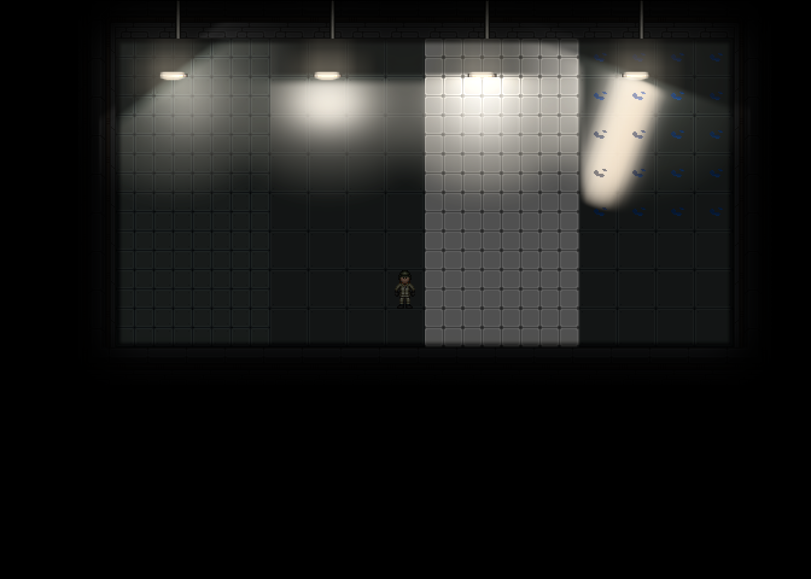

# CMU Cinematic Lighting V4

Продолжение PR #573. Все PNG в наборах сравнения получены нативным игровым клиентом.
Промежуточные неудачные итерации находятся в `iterations/` и не являются итоговым результатом.
Художественную приёмку выполняет человек; метрики и компиляция её не заменяют.

## Нативные сравнения

StableGarrisonMultiZ0, камера **225.5, −145.5**, viewport **1344×960**, одинаковые
персонаж, расстановка, питание и ambient во всех четырёх кадрах.

| Off | High | Ultra |
|---|---|---|
|  |  |  |

[Low](reference/quality-1.png), [параметры источников](reference/sources.csv),
[камера](reference/view.json), [проверка изображения](comparison.json).

Четыре контрольных материала слева направо: матовый металл, полированный металл,
кафель, мокрый металл. Все четыре освещены одинаковыми источниками.

| Off | High | Ultra |
|---|---|---|
|  |  |  |

[Low](materials/quality-1.png), [параметры](materials/sources.csv),
[метрики четырёх образцов](material-metrics.json).

Отдельная насыщенная промышленная сцена:
[Off](industrial/quality-0.png), [Low](industrial/quality-1.png),
[High](industrial/quality-2.png), [Ultra](industrial/quality-3.png).
Для каждого состояния сохранены все четыре пресета, sources.csv, view.json и промежуточные поля:
[лампа выключена](industrial-lamp-off/quality-3.png),
[экраны выключены](industrial-screens-off/quality-3.png),
[аварийная маска повёрнута](industrial-alarm/quality-3.png),
[прожекторы повёрнуты](industrial-spotlight/quality-3.png).

Нативные tone-mapped диагностические изображения:
[Direct](reference-direct/quality-2.png), [Indirect](reference-indirect/quality-2.png),
[контактные основания](reference-contacts/quality-2.png),
[отражения включённого источника](materials-reflections/quality-2.png),
[та же лампа выключена](materials-reflections-lamp-off/quality-2.png).
[Проверка source-off](material-source-off.json) подтверждает исчезновение отдельного
отражённого вклада; она не измеряет изменение общей яркости сцены.

`high-*.png` — восьмибитные копии промежуточных целей: значения HDR выше единицы
теряют информацию при таком экспорте. Для оценки их цвета используются нативные debug views,
для энергии/NaN/Inf — исходные данные GPU, не эти PNG.

Живые проверки [окна 800×600](resize-small/quality-3.png), viewport **672×480**,
и [масштаба камеры 0.8](zoom-08/quality-3.png) сохранены отдельно от основного сравнения.
После них камера/размер возвращены к исходным и выполнены десять нативных циклов Off/High.

## Архитектура

Сохраняются три существующих Content overlay и штатные PointLight, FOV, AO и порядок сущностей.
Direct/indirect вычисляются в линейном пространстве перед миром, specular — перед сущностями
и AO, эмиссия и оптическое свечение — после мира, перед штатными FOV и фильтрами зрения.
Общего цветового фильтра, затемнения сцены или множителя ambient нет.

| Эффект | Источник данных → буфер | Использование и цвет | Ограничение видимости |
|---|---|---|---|
| Native | Штатные PointLight → native-light-copy | Независимая копия настоящей карты света; исходный цвет сохраняется | Штатные тени/FOV; косметические параметры PointLight не меняются |
| Direct | Профиль, реальная поза и размер источника → irradiance | Нормированная квадратура 3/5 точек, для площадки 6/10; ранний light composite | Консервативный меш препятствий, native light mask, проверки источника и получателя |
| Indirect | Отдельный параметр indirect → тот же irradiance | Более короткая слабая цветная засветка; отдельное отключение | Те же геометрия и FOV, не распространение через стены |
| Emissive/Core | Текущий видимый кадр RSI, authored UV-маска, alpha/яркие пиксели → emission HDR | Только светящиеся пиксели настоящего спрайта; fallback при несовпадении ресурса | Видимость слоя, питание, состояние, FOV |
| Inner | Независимый innerGlow → inner-seeds → pyramid[0] | Компактный насыщенный ореол, без размытия мира | Endpoint/path-проверки неизменной R-маски и разрешённой лицевой поверхности G |
| Outer | Независимый outerGlow → outer-seeds → pyramid[1..] | Последовательное понижение разрешения, слабый широкий ореол | Те же проверки на каждом уровне |
| Specular | Material RGBA, реальная эмиссия, источник → reflections | Roughness и specularStrength; дешёвое сухое поле и пять выборок настоящей светящейся области для мокроты | Меш света/FOV; композитинг до персонажей и AO |
| Material | Реальные тайлы с наследованием, авторские поверхности, лужи → materials | R = reflectivity × specularStrength / 4, G = roughness, B = stretch, A = coverage | Проверки родителя и видимости; маска сама не рисует объекты |
| Atmosphere | Профиль, native LightMask, локальная плотность → atmosphere | В обычной комнате плотность 0.12 × пользовательская; промышленная задаётся явно | Меш, маска источника, FOV; нет общего тумана |
| Occlusion | Настоящие occluder → blockers.R | Жёсткая геометрия, без размытия маски | Исходная маска препятствий сохраняется |
| Wall face | Реальная светящаяся трубка и открытая сторона → blockers.G | Возвращает glow трубки на лицевой стороне стены, ранее полностью отсекавшийся R | Три геометрических маршрута, максимум 0.75 м, проверка входа/выхода из объединения solid, native FOV |
| Contact | Авторские основания статуи/диванов → blockers.B | Локальное затенение не сильнее 20%, перед optical glow; штатный AO сохранён | Только видимые статичные основания, без обводки всех спрайтов |
| Final | Предыдущие поля → текущий viewport | Плавное HDR-плечо с сохранением отношений каналов, без потолка vec3(0.22) | После этого движок применяет свой hard FOV, NV и HUD |

Пять Content-масок описывают трубки, терминалы, автоматы и два размера прожекторов.
Маска пересекается с настоящей alpha и выделением эмиссии: прямоугольник RSI не переносится
на пол. Направление, анимация, отключение питания и текущие сигнальные цвета остаются авторитетными.
Нейтральная лампа может выбрать обычный, тёплый или технический профиль по своей реальной
локальной ориентации крепления; координаты StableGarrison и камера в рендерере не используются.

Полированный металл концентрирует блик, матовый рассеивает слабый, кафель сохраняет швы,
мокрота вытягивает отклик и ограничивает его настоящей лужей. Это стилизованная 2D-модель,
не зеркальная копия мира, GI или PBR. Параметры, не участвующие в расчётах, не добавлены.

## Диагностика

`cmu_cinematic_debug` работает локально, не включает GPU readback и не меняет игровой свет.
Режимы: `native`, `direct`, `indirect`, `emissive`, `core`, `inner`, `outer`, `bloom`,
`reflections`, `materials`, `atmosphere`, `occlusion`, `contacts`, `final`.
`enable/disable direct|indirect|reflections|glow|atmosphere|contacts` независимо выключает вклад.
`all`/`off` сбрасывает диагностику, `quality 0` выключает всю систему.
Отдельных постоянных целей для direct/indirect или диагностики нет: используются существующие поля.

High владеет 14 targets, Ultra 15: два новых reduced-resolution HDR seed-поля разделяют
оптические масштабы. При 1344×960 это 22,357,440 / 22,362,480 байт. Каналы G/B прежнего
RGBA8 blockers переиспользованы для wall receiver/contact, без новых fullscreen-проходов.
Геометрия, позы и параметры шейдеров кешируются; расчёт маршрутов повторяется только
при изменении геометрии или светящейся области. Геометрический радиус больше не включает
внешний native-хвост, который все авторские проходы уже отбрасывают.

## Воспроизведение

Нужен Mapping, локальное имя проверить через `listplayers`.

```text
cmu_cinematic_demo localhost@Username reference
cmu_cinematic_demo localhost@Username view 225.5 -145.5
cmu_cinematic_demo localhost@Username capture 30
cmu_cinematic_demo localhost@Username materials
cmu_cinematic_demo localhost@Username capture 3
cmu_cinematic_demo localhost@Username industrial-static
cmu_cinematic_demo localhost@Username state lamp-off
cmu_cinematic_demo localhost@Username capture 3
```

Состояния: `all`, `lamp-off`, `screens-off`, `alarm`, `spotlight`, `alarm-off`, `spotlight-off`.
Они доступны только на изолированных review-картах. Main reference загружает настоящую
StableGarrisonMultiZ0, не меняет расстановку и ambient. Перед сравнением review-карта
ставится на паузу и фиксируется текущее значение анимированного ambient.
Камера, zoom, размеры, FOV, AO, exposure, атмосфера и ambient записываются и проверяются
между пресетами. `sources.csv` хранит реальные параметры источников, `view.json` — геометрию кадра.
Нативный viewport 1344×960 получен при окне 1920×1080, zoom 1.

Автоматическая проверка:

```text
python Tools/CMU14/Lighting/check-comparison.py <capture-directory> --output comparison.json
python Tools/CMU14/Lighting/check-comparison.py <material-directory> --stand --output materials.json
```

Пороги зафиксированы в quality-regions.json до первого V4-кадра. Проверяются зоны A–F,
локальность красного/голубого/тёплого, контраст персонажа, белое клиппирование, глубокая чёрная
область FOV, кандидаты прямолинейных границ с исключением исходных рёбер и швов тайлов.
Кандидат требует визуальной проверки; отсутствие кандидата не доказывает художественного качества.
Для source-off сравниваются нативные tone-mapped кадры debug reflections, а не 8-битная копия HDR.
Две тёплые области добавлены после сверки положения лампы на карте; используются прежние
общие цветовые пороги без ослабления. `--swatches` отдельно сообщает характеристики
четырёх фиксированных образцов, не подгоняя изображение или pass/fail под материал.

Промышленный стенд использует отдельные наследованные review-прототипы маяка и прожекторов
с `autoRot: true`, чтобы фиксированные углы состояния действительно меняли native LightMask.
Производственные прототипы сохраняют свои настройки. `all` возвращает исходные углы источников,
поэтому порядок выполнения состояний не меняет последующий контрольный кадр.

## Ограничения

Непрозрачная декоративная вода у статуи — отдельный спрайт, отрисованный после floor pass.
Она получает native/direct light, но закрывает добавленный floor specular. Настоящие лужи
участвуют в мокром отклике. Reflection pass намеренно не переносится поверх персонажей.
Нормали/зеркальные отражения и полное переосвещение мебели без данных поверхности не реализованы.
Проверки специальных камер/NV/Z в headless необходимо отличать от живого боевого раунда.
Маска мокроты строится по соединённым ячейкам настоящих луж со сглаженным внешним краем;
это не точная пиксельная alpha-маска каждого спрайта воды.

## Проверки

- Геометрия: **28/28**. Тонкие/диагональные препятствия, безопасный маршрут лицевой поверхности,
  объединение соседних solid-полигонов, наложенные препятствия, invalid radius, затухание вспышек,
  бюджеты, направление видимых оснований noRot/cardinal RSI при повороте камеры.
- Интеграция: **5/5** на Debug-снимке после исправления оснований. Прототипы/маски, независимые
  материалы и переключатели; 10 циклов всех пресетов; питание/контейнеры/скрытый родитель;
  настоящий угол native light animation и mount-relative LightMask; разные viewport/NV/Z;
  odd-size resize, HDR-форматы, очистка и однократное освобождение всех targets.
- Полный YAML linter с review-прототипами: **0 ошибок**, `No errors found in 773078 ms`.
- Сервер и Debug-клиент собраны без ошибок. Полный Release-клиент также собран без ошибок;
  предупреждения зависимостей и анализаторов сохранены в локальных журналах.

```text
dotnet test Content.Tests/Content.Tests.csproj --no-restore -p:BuildProjectReferences=false --filter FullyQualifiedName~CinematicLightingGeometryTest
dotnet test Content.IntegrationTests/Content.IntegrationTests.csproj --no-restore -p:BuildProjectReferences=false --filter FullyQualifiedName~CinematicLightingIntegrationTest
dotnet build Content.Client/Content.Client.csproj -c Release --no-restore -m:1 -nr:false -p:UseSharedCompilation=false
dotnet build Content.YAMLLinter/Content.YAMLLinter.csproj --no-restore -p:BuildProjectReferences=false
bin/Content.YAMLLinter/Content.YAMLLinter.exe
```

Проверка оснований обнаружила и исправила настоящий дефект: поворот entity на 180°
переносил тень noRot/cardinal-спрайта выше объекта. Контакт теперь использует ту же
геометрию ориентации, что и эмиссия. Неиспользуемый light-mask sampler хранит постоянную
белую текстуру вместо ссылки на старый viewport после resize.

Двери/тонкие препятствия и переключение видимости покрыты геометрическими/интеграционными
контрактами. Полная живая матрица боевых вспышек, взрывов, ксеноморфов/скрытых персонажей,
всех видов NV, наблюдения и камер на нескольких одновременно загруженных Z-уровнях
не выполнена; для этих случаев здесь не заявляется полноценная игровая приёмка.
